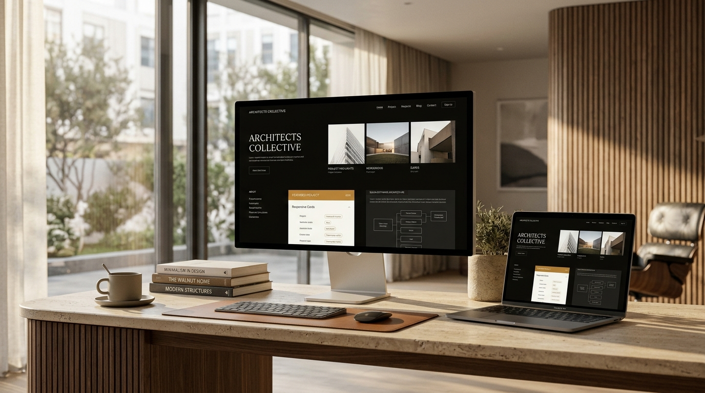
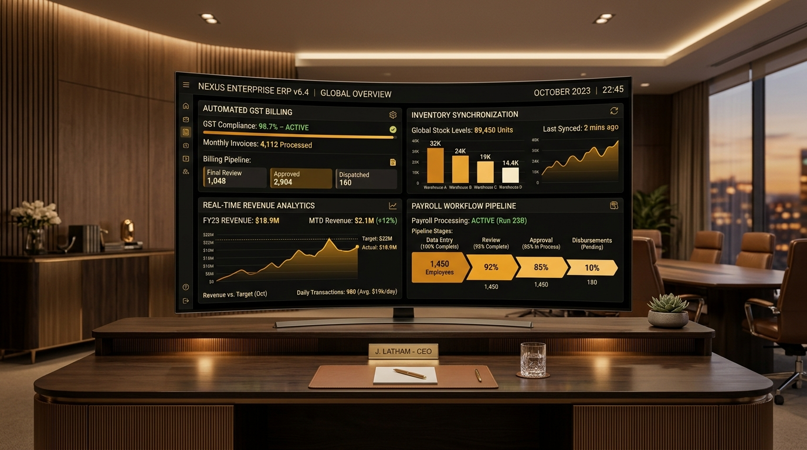
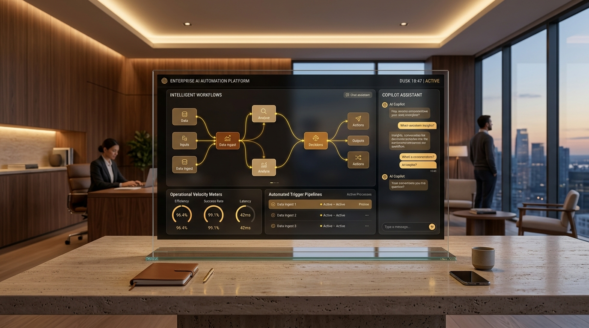
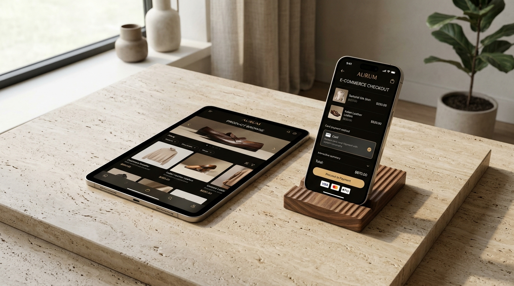

<a id="readme-top"></a>

# 🌟 Ecreation IT Solution — Premium Website, Lead-Conversion Engine & Admin ERP



[](https://nextjs.org/ "Next.js")
[](https://react.dev/ "React")
[](https://www.typescriptlang.org/ "TypeScript")
[](https://tailwindcss.com/ "Tailwind CSS")
[](https://supabase.com/ "Supabase")
[](https://vercel.com/new/clone?repository-url=https%3A%2F%2Fgithub.com%2Fchiranjibsahoo%2Fecreation-website-erp "Deploy on Vercel")
[](https://github.com/chiranjibsahoo/ecreation-website-erp/commits/main "Maintained")

> **Website Design & Development • Office Automation & Custom ERP • AI Workflow Automation • SEO & Social Media Growth • Mobile Apps • Cloud & Security**

The official corporate website of **Ecreation IT Solution** — a premium, fully responsive **Next.js 16 + React 19** web experience engineered to do one job exceptionally well: **turn visitors into enquiries.** It combines a luxury *Champagne-Ivory & 24K Gold* design system, a smart **AI Assistant chatbot**, strategically-timed **conversion popups**, and a built-in **Admin ERP portal** that captures, highlights, and analyses every lead by source.

---

<!-- Table of Contents -->
<details>
<summary>

## 📓 Table of Contents

</summary>

- [✨ Highlights](#-highlights)
- [🎯 Lead-Conversion Engine](#-lead-conversion-engine)
- [🛠️ Services Showcased](#️-services-showcased)
- [📸 Visual Showcase](#-visual-showcase)
- [🧭 Admin ERP Portal](#-admin-erp-portal)
- [📂 Folder Structure](#-folder-structure)
- [⚙️ Tech Stack](#️-tech-stack)
- [🧰 Getting Started](#-getting-started)
- [🔐 Environment Variables](#-environment-variables)
- [▲ Deploy on Vercel](#-deploy-on-vercel)
- [🎨 Theme & Gold Gradient Toggle](#-theme--gold-gradient-toggle)
- [🧩 Customize (Quick Guide)](#-customize-quick-guide)
- [🗺️ Roadmap](#️-roadmap)
- [🚀 Connect](#-connect)
- [🏷️ Recommended GitHub Topics](#️-recommended-github-topics)
- [🪪 Copyright](#-copyright)

</details>

---

## ✨ Highlights

- **🏆 Luxury Design System** — Warm Alabaster, Champagne-Ivory header, Deep Obsidian and 24K Champagne Gold accents, with consistent hover micro-animations across the menu, social rail, and floating dock.
- **📱 Fully Responsive** — Tuned from **320px phones to 4K desktops** and verified across Chrome, Edge, Safari, and Firefox.
- **🧭 Editorial Header & Mega-Menu** — Clean `Home · Services · Portfolio · Contact` navigation, a visual Services mega-dropdown, and a Login ⇄ **Logout** switch for signed-in admins.
- **🎞️ Cinematic Hero Slider** — Four service pillars with video backgrounds, with the pillar selector cards placed *below* the slider for a clean first impression.
- **🧲 Smart Floating UI** — Left **Quick Enquiry** button, left social rail, right section-jump dock with scroll-spy, and a 24/7 **Ecreation AI Assistant** launcher.
- **🔎 SEO-Ready** — Structured data (`Organization`, `WebSite`), rich metadata, Open Graph, and Twitter cards.
- **🔒 Privacy-Aware Contact** — Only the official email (`contact@ecreation.in`) is displayed publicly; no phone numbers are shown anywhere.

---

## 🎯 Lead-Conversion Engine

Every touchpoint feeds a single **leads pipeline** and is tagged with an **Enquiry Source**, so you always know what's working.

| Touchpoint | Trigger | Captures | Admin "Enquiry Source" |
|---|---|---|---|
| 🤖 **Ecreation AI Assistant** | Visitor chats | Phone + Email detected automatically from the conversation, plus an inline **Book Free Demo** form (Name, Phone, Email) | `Ecreation AI Assistant Chatbot` *(highlighted)* |
| ⏱️ **Engaged-Visitor Offer Popup** | Visitor stays 1–2 min without enquiring | Phone + Email only | `1-2 Min Engaged Visitor Offer Popup` |
| 🚪 **Exit-Intent Offer Popup** | Cursor heads for the browser close/tab bar | Phone + Email only | `Exit-Intent 25% Offer Popup` |
| ⚡ **Quick Enquiry** (left button) | Click | Phone + Email only | `Left Quick Enquiry 25% Offer Popup` |
| 📬 **Contact page form** | Submit | Full project brief | `direct` / page source |

**Built for trust & quality**

- Light, commercial-style **offer popups** that fit in a single view with no inner scrolling, with a coupon code, value badges, and a live countdown.
- **Strict validation** on both client and server: real 10–15 digit phone numbers (rejects `0000000000`-style fakes, enforces 6–9 start for 10-digit mobiles) and RFC-style email checks.
- A **honeypot** field filters bot spam, and popups stop once a visitor has already enquired.

---

## 🛠️ Services Showcased

| Service | What clients get |
|---|---|
| 🌐 **Website Design & Web Development** | Luxury corporate sites, e-commerce, Next.js portals with a CMS |
| 🏢 **Office Automation & ERP Software** | GST billing, inventory, HR/payroll, CRM suites |
| 📈 **Digital Marketing, SEO & Social Media** | Google ranking, brand management, paid campaigns |
| 🤖 **AI Solutions & Workflow Automation** | 24/7 AI sales chatbots, smart pipelines, business bots |
| 📱 **Mobile App Development** | iOS & Android business apps |
| ☁️ **Cloud Infrastructure & Cyber Security** | Hosting, database security, 99.99% uptime SLA |

---

## 📸 Visual Showcase

<table>
  <tr>
    <td align="center"><br/><sub><b>Website Design & Development</b></sub></td>
    <td align="center"><br/><sub><b>Office Automation & ERP</b></sub></td>
    <td align="center"><br/><sub><b>AI Workflow Automation</b></sub></td>
  </tr>
  <tr>
    <td align="center"><br/><sub><b>SEO & Social Media Growth</b></sub></td>
    <td align="center"><br/><sub><b>Mobile App Development</b></sub></td>
    <td align="center"><br/><sub><b>Cloud & Cyber Security</b></sub></td>
  </tr>
</table>

---

## 🧭 Admin ERP Portal

A secure back-office (`/admin`, sign in at `/login`) that turns raw enquiries into insight:

- **📥 Leads CRM** (`/admin/leads`) — Search, filter by status or source, export to **CSV**, and update status (`new → contacted → qualified → converted → archived`).
- **🎨 Source Highlighting** — AI Chatbot, Exit-Intent popup, and Engaged-Visitor popup leads each get a distinct colour badge and row highlight.
- **💬 AI Chat Logs** (`/admin/chats`) — Every Ecreation AI Assistant conversation is saved for transcript review and analysis.
- **📊 Dashboard** (`/admin`) — Totals by source, chat counts, and quick links to the CMS sections (Services, Blog, Projects).
- **🚪 Clear Logout** — Always visible in the header and in the admin layout.

> Leads and chat logs are persisted to **Supabase** when configured, and always mirrored to a local JSON store (`.data/`, git-ignored) so the admin panel works out-of-the-box in development.

---

## 📂 Folder Structure

```text
ecreation-website-erp/
├── public/
│   ├── images/            # Hero posters & service showcase artwork
│   └── videos/hero/       # Cinematic hero slider videos (.webm)
├── supabase/
│   └── migrations/        # SQL schema (leads, chat sessions, CMS tables)
├── src/
│   ├── app/
│   │   ├── (pages)        # about, blog, contact, projects, services, login, terms…
│   │   ├── admin/         # ERP dashboard, leads CRM, AI chat logs, CMS
│   │   └── api/           # contact, leads, chat-logs route handlers
│   ├── components/
│   │   ├── animations/    # Opening preloader & motion helpers
│   │   ├── forms/         # Offer popups, Quick Enquiry modal, contact forms
│   │   ├── home/          # Hero slider, services, showcase, estimator…
│   │   ├── layout/        # Navbar, Footer, social rail, floating dock, theme toggle
│   │   ├── support/       # Ecreation AI Assistant chatbot
│   │   ├── seo/           # JSON-LD schema markup
│   │   └── ui/            # shadcn / Base UI primitives
│   ├── lib/               # Supabase clients, seed data, local store
│   └── types/             # Shared TypeScript types
├── .env.local.example     # Environment variable template
└── package.json
```

---

## ⚙️ Tech Stack

[](https://nextjs.org/)
[](https://react.dev/)
[](https://www.typescriptlang.org/)
[](https://tailwindcss.com/)
[](https://supabase.com/)
[](https://vercel.com/)
[](https://git-scm.com/)

<!--- DEPENDENCIES_START --->
- **[next](https://www.npmjs.com/package/next)** (`16.4.6`) — App Router, server components, route handlers
- **[react](https://www.npmjs.com/package/react)** (`19.3.0`) — UI runtime
- **[tailwindcss](https://www.npmjs.com/package/tailwindcss)** (`4.3.3`) — Utility-first styling with the design-token layer
- **[motion](https://www.npmjs.com/package/motion)** (`^14`) — Smooth UI animation
- **[@base-ui/react](https://www.npmjs.com/package/@base-ui/react)** + **shadcn** — Accessible dialog, sheet, and form primitives
- **[@supabase/supabase-js](https://www.npmjs.com/package/@supabase/supabase-js)** + **@supabase/ssr** — Database & server-side auth
- **[lucide-react](https://www.npmjs.com/package/lucide-react)** — Crisp vector iconography
- **[tw-animate-css](https://www.npmjs.com/package/tw-animate-css)** — Entrance & micro-interaction utilities
<!--- DEPENDENCIES_END --->

---

## 🧰 Getting Started

### 1. Clone the Repository

```bash
git clone https://github.com/chiranjibsahoo/ecreation-website-erp.git
cd ecreation-website-erp
```

### 2. Install Dependencies

```bash
npm install
```

### 3. Configure Environment

```bash
cp .env.local.example .env.local
```

The site runs in **local mode** with no keys (leads are saved to `.data/`). Add Supabase keys to enable cloud persistence.

### 4. Start the Development Server

```bash
npm run dev
```

Open [http://localhost:3000](http://localhost:3000) to explore with hot reload.

### 5. Build & Run Production

```bash
npm run build
npm run start
```

---

## 🔐 Environment Variables

| Variable | Purpose |
|---|---|
| `NEXT_PUBLIC_SUPABASE_URL` | Your Supabase project URL |
| `NEXT_PUBLIC_SUPABASE_ANON_KEY` | Public anon key (browser-safe) |
| `SUPABASE_SERVICE_ROLE_KEY` | Server-only key for secured API routes. **Never expose this to the browser.** |
| `NOTIFICATION_WEBHOOK_URL` | *(Optional)* Webhook for new-lead alerts |
| `ADMIN_NOTIFICATION_EMAIL` | *(Optional)* Admin alert email |
| `NEXT_PUBLIC_SITE_URL` | Canonical site URL for metadata |

> 🔒 `.env*` files are git-ignored. Never commit real keys. Apply the SQL in [`supabase/migrations`](./supabase/migrations) to your Supabase project before enabling cloud mode.

---

## ▲ Deploy on Vercel

[](https://vercel.com/new/clone?repository-url=https%3A%2F%2Fgithub.com%2Fchiranjibsahoo%2Fecreation-website-erp)

1. Sign in at [vercel.com/new](https://vercel.com/new) with GitHub.
2. Import **`chiranjibsahoo/ecreation-website-erp`**.
3. Add the environment variables above, then click **Deploy**.

---

## 🎨 Theme & Gold Gradient Toggle

The site ships with a **reversible 24K metallic gold gradient layer** for a polished finish.

- A small **"Gold Gradient"** switch (bottom-left) flips between the gradient and the original flat-gold theme, and remembers your choice.
- All gradient rules live in one block in [`src/app/globals.css`](./src/app/globals.css), driven by `<html data-gold-gradient="true|false">`.
- **To remove it permanently:** delete `<GoldGradientToggle />` and the `data-gold-gradient` attribute in [`src/app/layout.tsx`](./src/app/layout.tsx).

---

## 🧩 Customize (Quick Guide)

- **Company details & services:** [`src/lib/data/seedData.ts`](./src/lib/data/seedData.ts)
- **Header & menu:** [`src/components/layout/Navbar.tsx`](./src/components/layout/Navbar.tsx)
- **Hero slider & pillars:** [`src/components/home/FullscreenVideoHero.tsx`](./src/components/home/FullscreenVideoHero.tsx)
- **Offer popups (timing, copy, coupon):** [`src/components/forms/ExitOfferPopup.tsx`](./src/components/forms/ExitOfferPopup.tsx)
- **Quick Enquiry modal:** [`src/components/forms/HeaderEnquiryModal.tsx`](./src/components/forms/HeaderEnquiryModal.tsx)
- **AI Assistant flow & replies:** [`src/components/support/AiChatbot.tsx`](./src/components/support/AiChatbot.tsx)
- **Lead validation & storage:** [`src/app/api/contact/route.ts`](./src/app/api/contact/route.ts)
- **Colours & gradients:** [`src/app/globals.css`](./src/app/globals.css)

---

## 🗺️ Roadmap

- [ ] WhatsApp click-to-chat (link only, no number displayed)
- [ ] Cost estimator → emailed quote
- [ ] Client logo strip & video testimonials
- [ ] Booking calendar for discovery calls
- [ ] Admin lead alerts (email / webhook) and analytics charts
- [ ] English / Hindi language toggle

---

## 🚀 Connect

[](https://github.com/chiranjibsahoo)

- **GitHub:** [github.com/chiranjibsahoo](https://github.com/chiranjibsahoo)
- **Business Email:** [contact@ecreation.in](mailto:contact@ecreation.in)
- **Website:** [ecreation.in](https://ecreation.in)

---

## 🏷️ Recommended GitHub Topics

`nextjs` `react` `typescript` `tailwindcss` `supabase` `corporate-website` `lead-generation` `erp` `admin-dashboard` `chatbot` `conversion-optimization` `seo` `vercel`

---

## 🪪 Copyright

© Ecreation IT Solution. All rights reserved. Brand assets, copy, and imagery are proprietary to Ecreation IT Solution.

<p align="right">(<a href="#readme-top">back to top ↑</a>)</p>
